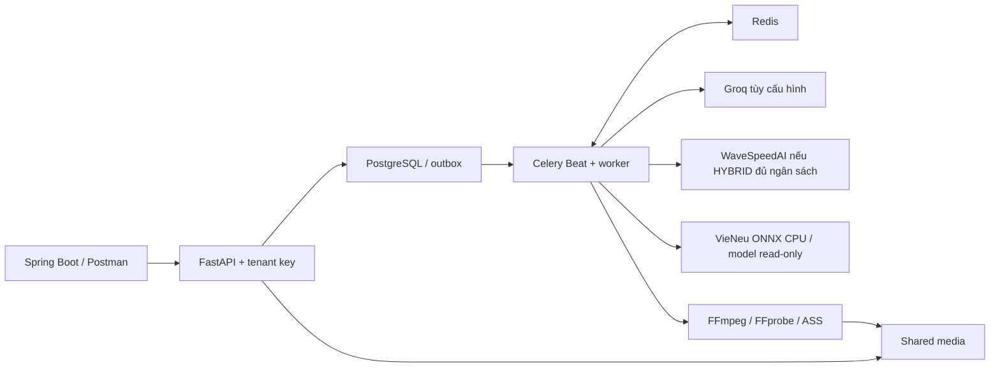

# Báo cáo bàn giao AI Travel Video Service

## 1. Executive Summary

Phase 3 hoàn thiện Docker Compose, kiểm tra model, bổ sung kiểm thử các đường render và bàn giao Postman cùng hợp đồng Java. Kết quả thực tế phân biệt rõ giữa mock, inference local và yêu cầu live. API sử dụng contract hiện có và cơ sở dữ liệu tiếp tục dùng hai migration đã có.

## 2. Final Architecture

## 3. Project Structure

`app/api`, `schemas` và `repositories` chứa contract và truy vấn theo tenant. `app/services`, `providers`, `renderers`, `workers` và `storage` xử lý lifecycle, provider, TTS/media và lưu file. `tests/` chứa regression, `scripts/` chứa smoke E2E, `postman/` chứa collection/environment, `models/tts/` là bundle local bị bỏ qua trong Git và build context. [Phân tích kiến trúc](PROJECT_ANALYSIS_WAVESPEED_MIGRATION.md)

## 4. Implemented Features

POST asset binary, submit 202, trạng thái, lịch sử và tải MP4 theo tenant. PostgreSQL outbox và Celery xử lý retry/resume. Groq storyboard tùy chọn, video HYBRID tối đa hai clip, TTS local, subtitle ASS, ducking và output H.264/AAC 30/35/40 giây. Mức kiểm chứng cụ thể ở các phần 14–18.

## 5. Groq AI Director Integration

Director viết storyboard tiếng Việt và prompt tiếng Anh. Worker kiểm schema, timeline, asset và giới hạn AI, lưu model/token usage trong metadata job, rồi dùng lại khi resume. Phase 3 có bài test LOCAL xuyên từ Groq mock sang audio tổng hợp mock, caption và output thật qua FFmpeg. Giữ cấu hình Director ở worker. [Báo cáo Director](GROQ_AI_DIRECTOR_REPORT.md)

## 6. WaveSpeedAI Integration

Adapter xác minh prediction ID, poll và tải clip đầu ra. HYBRID giữ dynamic prompt, mỗi slot có budget và prediction riêng. Lỗi submit mơ hồ được lưu để tránh POST thêm. Wan legacy còn dùng để resume theo provider đã lưu. Mock tích hợp kiểm hai clip qua poll, tải, TTS, subtitle và MP4. [Adapter](app/providers/wavespeed.py) · [HYBRID](app/services/hybrid.py)

## 7. Local TTS Integration

VieNeu v3 Nano `vieneu==3.5.4`, CPU ONNX, revision `a239fbfe19ca572f1d5f4316521806ddacc0b279`. Sáu file tổng 281.756.486 byte. Setup kiểm SHA-256 theo manifest từ bundle ghim phiên bản đã xác minh, có chế độ `--check` không mạng. Model card xác nhận Apache-2.0 cho weights, presets và quyền dùng audio tạo ra trong nội dung thương mại. [TTS report](LOCAL_TTS_VIDEO_PIPELINE_REPORT.md) · [Model card](https://huggingface.co/pnnbao-ump/VieNeu-TTS-v3-Nano/blob/a239fbfe19ca572f1d5f4316521806ddacc0b279/README.md)

## 8. Narration and Subtitle Pipeline

Voice upload được ưu tiên. Sau đó worker dùng custom text, storyboard đã lưu hoặc template. WAV cache theo scene và nội dung; FFprobe đo duration; xử lý silence/tempo trong giới hạn để khớp scene. ASS có font Việt và timing mức segment; text được escape. [Narration](app/services/narration.py) · [ASS](app/services/subtitles.py)

## 9. FFmpeg Rendering Pipeline

FFmpeg giữ media cut/zoom/crossfade theo storyboard, thêm marketing caption/CTA, ghép voice và music có ducking/limiter và burn-in ASS. FFprobe kiểm codec, stream, duration, kích thước, 30 FPS và pixel format. Đường render worker chạy gate black/freeze trước khi commit COMPLETED. [FFmpeg](app/renderers/ffmpeg.py)

## 10. Docker Configuration

Python 3.12 slim, FFmpeg/FFprobe, DejaVu và non-root UID 10001. Dependency layer tách trước source; target `tts-worker` thêm SDK/ONNX, model mount read-only. API lược các secret Groq/WaveSpeed/Wan bằng override rỗng. Worker healthcheck kiểm Celery qua Redis, model/SDK nếu bật. API readiness kiểm PostgreSQL và Redis độc lập với provider. Deployment test dùng tên project và env riêng, không thao tác volumes stack chính. [Dockerfile](Dockerfile) · [Compose](docker-compose.yml) · [Worker health](app/workers/health.py)

## 11. Environment Variables

Xem [.env.example](.env.example) theo nhóm deployment, DB, broker, Groq, WaveSpeed, Wan legacy, TTS và media. Các cờ AI trả phí mặc định tắt. Bật TTS dùng `VIDEO_WORKER_TARGET=tts-worker`, `TTS_ENABLED=true` và `TTS_MODEL_HOST_DIR` tương ứng. Compose mặc định 4 CPU/4 GB cho worker, TTS một slot mặc định. `SERVICE_ENV_FILE` giúp giữ khác biệt giữa runtime env test và triển khai.

## 12. API Inventory

| Method | Route |
|---|---|
| GET | /health/live, /health/ready, /docs, /openapi.json |
| POST | /api/v1/videos/assets, /api/v1/videos/generate |
| GET | /api/v1/videos, /api/v1/videos/{jobId}, /api/v1/videos/{jobId}/download |

Có chín request JSON đã validate bằng Pydantic. Tài liệu Java mô tả submit, bounded polling, timeout/idempotency, download, FAILED, executionMode và cost uncertainty. Workspace thiếu dự án Java hiện hữu. [API và Spring Boot](API_AND_SPRING_BOOT.md)

## 13. Postman Collection

Bảy folder và 32 requests, 46 script handlers đã kiểm cú pháp JavaScript. JSON parse thành công và secrets mẫu rỗng. Test thực thi script xác nhận cả 13 request sinh job đều bị bỏ qua với env mặc định. Có case idempotency, 409, tenant và HTTP validation. [Collection](postman/AI-Travel-Video-Service.postman_collection.json) · [Environment](postman/Local-Environment.postman_environment.json)

## 14. Automated Test Results

**VERIFIED WITH MOCK** và FFmpeg/PostgreSQL thật. Lần chạy toàn bộ Docker ở PostgreSQL test tmpfs có **138/138 đạt, 0 lỗi, 0 skip**, **339,38 giây**. Groq, WaveSpeed và TTS được mock trong suite mặc định. Hai bài E2E mock kiểm Groq→LOCAL có giữ lời dẫn và HYBRID→hai prediction→download→TTS→ASS→MP4. Một cảnh báo Starlette TestClient từ dependency. Bộ 30/35/40 giây, 16:9 và 9:16 chạy qua kiểm tra FFprobe/quality. Sau khi sửa lỗi lặp từ “ngày”, chạy riêng **11 ca chuẩn hóa đạt**, gồm một ca mới, và Ruff đạt trên source cuối.

## 15. Local TTS Inference Evidence

**VERIFIED WITH REAL LOCAL TEST.** Image worker build cuối chạy bằng `docker run --network none` và mount model read-only. Mẫu gồm địa danh, 3N2Đ, 2.990.000 VNĐ, 20% và 20/12/2026. Sau khi sửa lặp từ “ngày” trước ngày tháng, normalize thành một “ngày” và tổng hợp thật. [WAV số liệu tiếng Việt](artifacts/phase3-vieneu-vi-numbers.wav) dài **9,400 giây**, PCM s16le, **24.000 Hz**, mono. Lần gọi gồm load model và synthesize mất **7,705 giây**, subprocess RSS đỉnh **486.264 KiB**. Chưa có đánh giá nghe thử về phát âm.

## 16. LOCAL Offline Video Evidence

**VERIFIED WITH REAL LOCAL TEST.** Kiểm chứng bằng HTTP trên project Compose riêng. PostgreSQL, Redis, API và worker đều healthy. `/health/live`, `/health/ready`, `/docs`, `/openapi.json` đều trả 200. Hai POST cùng payload trả 202 và cùng jobId `7dd29f27-553b-42c0-8412-6017b9eb3206`. Worker chuyển QUEUED → RENDERING → COMPLETED và endpoint download trả 200 sau khoảng **52,27 giây**. Groq, WaveSpeed và Wan tắt. Nguồn là hai asset UUID upload từ minh họa tự tạo.

[MP4 mẫu](artifacts/phase3-local-offline.mp4) có **40,000 giây**, **1920×1080**, H.264, YUV420P, **30 FPS**, AAC stereo **48 kHz**, **2.453.223 byte**. Asset metadata xác nhận sáu đoạn voiceover (8,031 giây lời đọc) và `subtitleBurnedIn=true`. Peak audio đo được **−6,8 dBFS**. Đoạn 38,0–39,5 giây có **45/45 frame khác nhau**. Quality gate black/freeze của worker đạt. Đây là mẫu minh họa không có nhạc nền. Ducking và limiter được kiểm ở suite riêng.

Quan sát [frame mở đầu](artifacts/phase3-local-offline-hook.png) và [frame CTA](artifacts/phase3-local-offline-cta.png) cho thấy chữ có dấu, phụ đề nằm thấp hơn marketing caption và CTA hiển thị. Sample chưa dùng logo. Kết quả chỉ đánh giá hai frame và kiểm kỹ thuật, không đánh giá toàn bộ chất lượng thẩm mỹ hoặc phát âm.

## 17. Groq Live Test Evidence

**NOT VERIFIED**. Chưa có phê duyệt sử dụng tài khoản/quota ở Phase 3. Sau khi được duyệt, kiểm một GET /models bằng key worker, rồi một completion cho job LOCAL. Lưu model và token usage từ metadata internal. Khi model thiếu hoặc lỗi 401/429, giữ lỗi/provider và policy fallback hiện tại. [Groq configuration](README.md#ai-director-với-groq)

## 18. WaveSpeedAI Live Test Evidence

**NOT VERIFIED**. Chuẩn bị canary một clip 720p/5 giây/audio off, final 40 giây, `aiScenes=1`, budget USD 0,1250, `allowLocalFallback=false`. Bật paid flags và chạy riêng chỉ sau phê duyệt. Xác nhận prediction completed, ID không trùng, clip hợp lệ và executionMode HYBRID. Estimate không phải invoice. [Request mẫu](API_AND_SPRING_BOOT.md) · [Giá WaveSpeedAI](https://wavespeed.ai/models/alibaba/wan-2.6/image-to-video-flash)

## 19. Resource Usage

Docker Desktop server 29.0.1, Compose v2.40.3-desktop.1, Linux với 12 CPU khả dụng. Snapshot worker trong render là **263,92% CPU**, **859,2 MiB / 4 GiB**. Đây là một điểm đo, chưa đo peak toàn job. UID **10001**, media ghi được, weights đọc được, FFmpeg/FFprobe **7.1.5**, DejaVu Sans được fontconfig tìm thấy. Alembic ở `0002_hybrid_generation (head)`. Cache dependency được tái sử dụng khi build lại cả ba image.

## 20. Cost Management

LOCAL offline tránh Groq/WaveSpeed và cloud TTS; CPU, điện, storage vẫn có chi phí vận hành. LOCAL/Groq thường một completion mỗi job và token usage tách khỏi trường USD video. HYBRID kiểm giá WaveSpeed bằng Decimal, maxAiCostUsd, lease và POST một lần khi trạng thái không rõ. Ghi `aiCostUncertain` nếu provider thiếu billing evidence. Giá tham chiếu một clip 5 giây 720p/audio off là 0,1250 USD, hai clip là 0,2500 USD. [Bảng giá WaveSpeedAI](https://wavespeed.ai/docs/docs-api/alibaba/alibaba-wan-2.6-image-to-video-flash)

## 21. Security Review

- Service key gắn với tenant; query và filesystem asset/output dùng tenant. Secrets trong Settings dùng SecretStr. API key provider chỉ có giá trị trong worker.
- HTTPS cổng 443, DNS kiểm địa chỉ định tuyến công khai và pin kết nối. Downloader không theo redirect và không truyền Bearer key provider đến host kết quả. WaveSpeed hiện dùng policy host công khai có DNS pin, chưa có CDN hostname allowlist xác minh từ live.
- Upload và download có giới hạn kích thước; MIME và dữ liệu được kiểm. FFmpeg dùng argv và file local với protocol whitelist. ASS dùng filename cố định và escape ký tự điều khiển.
- Groq chỉ nhận các chỉ số asset và text đã giới hạn, kết quả qua schema/kiểm nghiệp vụ. Log lỗi provider chuẩn hóa và không xuất key. [Asset validation](app/services/assets.py) · [Auth](app/core/security.py) · [Groq Director](app/services/ai_director.py)
- `pip-audit` lần đầu báo 12 dòng advisory cho một package là pip 25.0.1, tương ứng sáu ID riêng. Đã ghim pip 26.3 trong hai image triển khai. Build lại và `pip check` đạt, stack test healthy. Quét lại các package Python đã cài trong tts-worker trả **No known vulnerabilities found**. Phạm vi quét giới hạn ở dependency Python của image worker. [Pip release](https://pypi.org/project/pip/26.3/)

## 22. Known Limitations

Model Nano ở preview. Kiểm kỹ thuật sample nhằm xác nhận codec, âm thanh và phụ đề; mức tự nhiên/phát âm vẫn cần nghe thử. Cue ASS đồng bộ mức segment. Postman chưa chạy Desktop Runner và Java sample chưa tích hợp với dự án backend thực. Workspace thiếu metadata Git. Các giới hạn provider live và usage ghi riêng ở phần 17–18.

## 23. Deployment Instructions

Chuẩn bị `.env` từ mẫu, giữ tenant key và DB secret riêng. Chạy kiểm model với `--check`, bật TTS worker target nếu cần, kiểm `docker compose config --quiet`, rồi build và up với healthcheck. Khi dùng LOCAL offline chọn ảnh UUID nội bộ và tắt Director/paid flags. Khi chuyển profile hybrid live, kiểm outbox và ngân sách trước khi chạy. [README](README.md)

## 24. Remaining Work

Chạy canary Groq và WaveSpeed sau khi có quyền sử dụng tài khoản, đối soát billing và kiểm tra cùng backend Spring Boot thực. Nghe thử voiceover tiếng Việt và đo nhu cầu CPU/RAM trên máy triển khai. Chưa có kết luận production-ready.

### File tạo và chỉnh sửa

- Mới: `app/workers/health.py`, `scripts/phase3_smoke.py`, `API_AND_SPRING_BOOT.md`, hai file Postman và báo cáo này.
- Chỉnh: `Dockerfile`, `docker-compose.yml`, `.env.example`, `setup_tts_model.py`, `README.md`, `app/services/text_normalization.py`, `tests/test_execution.py`, `tests/test_hybrid.py` và `tests/test_text_normalization.py`.

