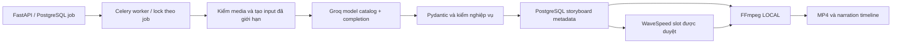

# Báo cáo triển khai Groq AI Director

## 1. Implementation Summary

Phase 1.1 thêm Groq để lên kịch bản cho LOCAL và HYBRID. Storyboard hợp lệ quyết định thứ tự cảnh, media, caption, narration và nội dung prompt cho từng clip WaveSpeedAI. Nếu Director bị tắt, worker giữ luồng Python hiện hành. Provider WaveSpeed, adapter Wan legacy, job status REST, schema PostgreSQL và Alembic tiếp tục dùng cấu trúc Phase 1. [Execution](app/services/execution.py) · [HYBRID](app/services/hybrid.py)

## 2. Files Created and Modified

| Thay đổi | File |
|---|---|
| Thêm client, schema và orchestration | [groq.py](app/providers/groq.py), [schemas/storyboard.py](app/schemas/storyboard.py), [ai_director.py](app/services/ai_director.py) |
| Tích hợp worker và render | [execution.py](app/services/execution.py), [hybrid.py](app/services/hybrid.py), [services/storyboard.py](app/services/storyboard.py), [local_video.py](app/services/local_video.py) |
| Định dạng chữ ký hàm theo Ruff | [wavespeed.py](app/providers/wavespeed.py) |
| Cấu hình, trường tùy chọn và vận hành | [config.py](app/core/config.py), [video.py](app/schemas/video.py), [.env.example](.env.example), [docker-compose.yml](docker-compose.yml), [README.md](README.md) |
| Thêm test | [test_groq.py](tests/test_groq.py), [test_ai_director.py](tests/test_ai_director.py), [test_storyboard.py](tests/test_storyboard.py) |
| Cập nhật test hiện có | [conftest.py](tests/conftest.py), [test_execution.py](tests/test_execution.py), [test_hybrid.py](tests/test_hybrid.py), [test_wavespeed.py](tests/test_wavespeed.py) |

## 3. Groq API Integration

Client dùng `http.client`, Bearer key và host HTTPS `api.groq.com` trên cổng 443. `GET /openai/v1/models` kiểm tra model active trên tài khoản trước `POST /openai/v1/chat/completions`. Mặc định chọn `openai/gpt-oss-120b`, có structured output strict theo tài liệu Groq. Các model khác ngoài allowlist strict dùng JSON object mode và qua cùng kiểm chứng Pydantic. Khi model thiếu hoặc trả HTTP 404, chọn `GROQ_MODEL` từ catalog của tài khoản. [Client](app/providers/groq.py) · [Models](https://console.groq.com/docs/models) · [Structured Outputs](https://console.groq.com/docs/structured-outputs) · [API reference](https://console.groq.com/docs/api-reference)

## 4. AI Director Architecture

Input chỉ gồm metadata tour đã giới hạn, các chỉ số media đã được kiểm, mode, aspect ratio, duration và giới hạn cảnh. URL, UUID, key, tenant ID và dữ liệu media không được gửi dưới dạng trường input. URL và mẫu credential rõ ràng trong văn bản tour được che. System prompt coi dữ liệu người dùng là dữ liệu không tin cậy, giới hạn Groq ở tác vụ sáng tạo. `tour.targetAudience` là tùy chọn tương thích ngược. [Input và prompt](app/services/ai_director.py) · [Tour schema](app/schemas/video.py)

## 5. Structured Storyboard Schema

`DirectorStoryboard` gồm `campaignTitle`, `creativeConcept`, `durationSeconds`, `aspectRatio`, `language` và `scenes`. Mỗi cảnh có ID, timeline, loại, asset index, prompt nullable, narration, caption và transition. Python kiểm khung hình, duration 30/35/40 giây, timeline liên tục, hook 3–5 giây, cảnh local cuối dành cho CTA, đúng asset và loại media, prompt/narration khác nhau ở các vị trí liên quan và tối thiểu 5 giây local. `cut` dùng tại biên AI, `crossfade` dùng giữa hai cảnh local. Text sinh ra chỉ dùng làm nội dung prompt/caption/narration. [Schema](app/schemas/storyboard.py) · [Validation](app/services/ai_director.py) · [Renderer adapter](app/services/storyboard.py)

## 6. Dynamic WaveSpeedAI Prompts

Cảnh AI chọn ảnh đã được kiểm từ request của tenant và dùng lại preflight JPEG của HYBRID. Python thêm yêu cầu giữ nguyên địa danh và bố cục, dùng chuyển động chậm, tránh biến dạng, chữ, logo và audio. Prompt được ghi theo slot tại bước reserve trước POST, kể cả khi worker không nhận được phản hồi, và được lưu vào scene output nếu clip đã render. Director đặt `generate_audio=false` cho job WaveSpeed do nó điều phối. Giá và spec được kiểm lại trước submit. [HYBRID](app/services/hybrid.py) · [WaveSpeed](app/providers/wavespeed.py) · [Output scenes](app/services/local_video.py)

## 7. Vietnamese Narration Generation

Groq được yêu cầu viết tiếng Việt tự nhiên, ngắn, tránh lặp và giữ nguyên sự kiện tour. Python kiểm độ dài từng cảnh, giới hạn từ xấp xỉ ba từ mỗi giây, từ chối narration trùng và chữ số ngoài dữ liệu tour. Trình dựng lưu `narrationTimeline` với `fps`, `startFrame`, `durationFrames`, narration, caption, loại cảnh và transition. Template dùng nội dung tour đã có và câu mở/CTA ngắn khi phù hợp. Số từ là tiêu chí soạn thảo, thời lượng audio cần FFprobe sau khi có TTS. [Validation](app/services/ai_director.py) · [Narration timeline](app/services/storyboard.py) · [Output metadata](app/services/local_video.py)

## 8. Workflow Integration

Worker lấy advisory lock, load request, kiểm media bằng downloader và resolver theo tenant, sau đó tạo hoặc đọc storyboard. HYBRID xác định số slot có thể trả phí theo budget và giữ cơ chế outbox, lease, polling và download của Phase 1. Sau khi FFmpeg xác thực và lưu MP4, worker cập nhật COMPLETED và cung cấp download như trước. LOCAL có Director dùng Groq và FFmpeg. LOCAL tắt Director chỉ dùng đường Python/FFmpeg và có thể tải media HTTPS của job. [Execution](app/services/execution.py) · [HYBRID](app/services/hybrid.py)

## 9. Persistence and Idempotency

Storyboard, nguồn, token usage và prompt nằm trong một row `VideoAsset` nội bộ với content type `application/vnd.travel.storyboard+json`. Row output `video/mp4` vẫn riêng. Giữ nguyên `request_payload` và so sánh canonical request. Advisory lock của job bảo vệ tính duy nhất của row. Worker ghi `STARTED` trước completion. Nếu mất worker trong cửa sổ chưa lưu response, resume áp dụng fallback hoặc báo `GROQ_INTERRUPTED`, tránh tạo completion trùng. Job Wan hoặc WaveSpeed cũ đã có generation row tiếp tục theo luồng cũ. [Persistence](app/services/ai_director.py) · [Canonical request](app/services/videos.py) · [Advisory lock](app/services/execution.py)

## 10. Cost and Token Management

Một job thông thường dùng một GET kiểm model và một completion. Catalog có thể giới hạn token thấp hơn cấu hình. Retry có giới hạn theo request và cửa sổ Director, không đổi model khi hết quota. Token usage do Groq trả về được lưu riêng. Các trường USD public tiếp tục chỉ phản ánh video generation. Ai Director không gán chi phí Groq mặc định. WaveSpeed tiếp tục kiểm giá bằng Decimal, budget tổng và giới hạn tối đa hai slot. [Groq](app/providers/groq.py) · [Budget](app/services/hybrid.py)

## 11. Fallback Strategy

Thiếu key, lỗi xác thực/quyền/model, lỗi HTTP tạm thời sau retry, lỗi response hoặc storyboard đều có mã riêng. Khi `AI_DIRECTOR_FALLBACK_ENABLED=true`, worker ghi `TEMPLATE_FALLBACK` và dựng bằng template Python với narration ngắn cùng các prompt cơ bản theo slot. Khi tắt cờ, worker trả trạng thái FAILED qua cơ chế lỗi hiện có. Tích hợp video vẫn theo `allowLocalFallback` của job. [Error policy](app/providers/groq.py) · [Fallback](app/services/ai_director.py)

## 12. Environment Configuration

| Biến | Mặc định |
|---|---|
| `AI_DIRECTOR_ENABLED` | `false` |
| `AI_DIRECTOR_PROVIDER` | `groq` |
| `GROQ_API_KEY` | Rỗng, worker dùng khi bật Director |
| `GROQ_BASE_URL` | `https://api.groq.com/openai/v1` |
| `GROQ_MODEL` | `openai/gpt-oss-120b` |
| `GROQ_TIMEOUT_SECONDS` | `60` |
| `GROQ_MAX_COMPLETION_TOKENS` | `4096` |
| `GROQ_MAX_RETRIES` | `1` |
| `AI_DIRECTOR_FALLBACK_ENABLED` | `true` |
| `AI_DIRECTOR_MAX_SCENES` | `8` |

Compose chỉ cấp key có giá trị cho worker, giá trị trong API container được ghi đè rỗng. Client dùng thư viện chuẩn Python, dùng lại image và dependencies hiện tại. [Settings](app/core/config.py) · [Compose](docker-compose.yml) · [Env mẫu](.env.example)

## 13. Test Results

- `docker compose config --quiet` trả mã 0. Kiểm tra cú pháp 41 file Python đạt. `ruff check app tests` đạt sau khi sửa hai dòng quá dài.
- Pytest chạy toàn bộ 119 ca trong Docker Linux với PostgreSQL test riêng và FFmpeg thật. Kết quả lần chạy toàn bộ là 117 đạt và 2 lỗi test WaveSpeed có từ Phase 1. Một assertion gọi helper đã bỏ. Mock transport còn lại nhận `SystemExit` như response thường. Sau khi sửa hai test, chạy lại đúng hai ca và cả hai đạt. Tổng cộng 119 ca được xác minh qua lần chạy toàn bộ và lần chạy có chọn lọc. Pytest ghi một cảnh báo tương thích TestClient từ Starlette.
- Bài test kiểm model và auth, schema strict, storyboard/timeline sai, nguồn media và ngân sách, hai prompt riêng, persistence khi retry/poll, idempotency, fallback 429 và model unavailable, cùng render LOCAL có narration timeline. Các request AI dùng mock. Không thực hiện smoke test Groq hoặc generation WaveSpeedAI trả phí.

## 14. Remaining Issues

- Quyền model, response strict thực tế, chất lượng ngôn ngữ/độ chính xác ngữ nghĩa và chi phí Groq chưa được xác nhận bằng tài khoản thật. Kiểm tra số, schema và điều kiện nghiệp vụ giảm lỗi có thể phát hiện bằng Python. Chất lượng factual của bản sao quảng cáo vẫn cần đối chiếu với dữ liệu tour.
- Media có thể được đọc khi kiểm input và đọc lại khi render. Asset URL cần còn truy cập được trong các bước của job. Director tắt mặc định.
- Window worker mất sau khi Groq nhận POST có thể vẫn tính token hoặc phí. Durable marker ngăn tạo completion mới sau sự cố. Các retry được cấu hình vẫn có thể tạo thêm lượt trong một lần chạy khi gặp lỗi mạng.
- Workspace hiện tại thiếu Git metadata nên `git status` không xác minh được thay đổi của worktree. Những đường dẫn Phase 1 chỉ được sửa tại các điểm tích hợp Director.

## 15. Preparation for Local TTS Phase

Đọc `narrationTimeline` từ metadata của asset `video/mp4`. Dùng `fps` và `startFrame` để đặt voiceover đúng cảnh. Sau khi tạo audio local ở Phase 2, đo bằng FFprobe, điều chỉnh nội dung nếu quá thời lượng cảnh và ghép vào pipeline voiceover hiện có. Phase 1.1 chỉ xuất kịch bản và timeline. [Timeline](app/services/storyboard.py) · [FFmpeg audio](app/renderers/ffmpeg.py)

