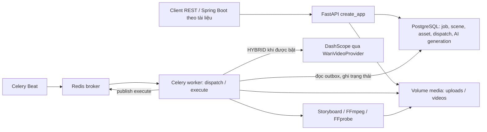
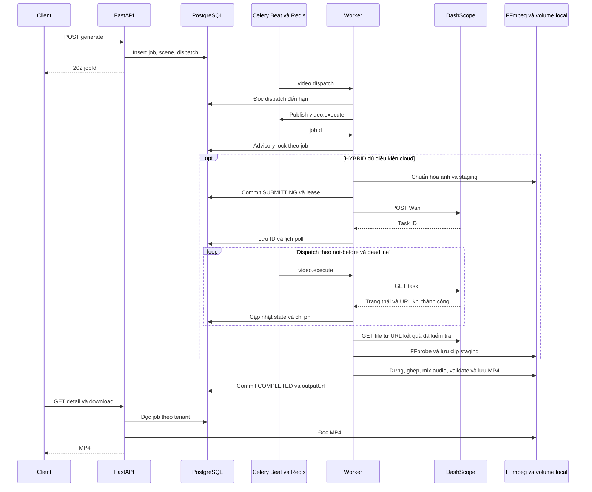
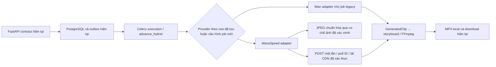

# 1. Executive Summary

Microservice đã có hai luồng LOCAL và HYBRID. API nhận job bất đồng bộ, PostgreSQL lưu trạng thái và hàng đợi bền vững, Celery/Redis dispatch, FFmpeg dựng MP4 30/35/40 giây và API tải file từ volume dùng chung. HYBRID có tối đa hai clip AI và adapter Wan đã có protocol riêng. Điểm cần sửa chính nằm ở lựa chọn adapter, cách chuẩn bị ảnh gửi WaveSpeedAI, chính sách billing và resume job theo provider đã lưu. [API](app/api/videos.py#L27) · [Worker](app/services/execution.py#L84) · [Hybrid](app/services/hybrid.py#L261) · [Provider](app/providers/base.py#L46)

Bằng chứng Postman do người dùng cung cấp xác nhận WaveSpeedAI đã nhận POST và trả prediction ở trạng thái `created`. Kết quả GET hoàn tất, CDN, định dạng tải về và phí thực tế chưa có bằng chứng runtime. Cloudinary, Full AI và endpoint hủy/retry chưa được triển khai trong dự án. Kiểm tra tĩnh Compose thành công. Pytest chưa chạy, xem mục 12.

# 2. Project Structure

Cây dưới đây lấy từ thư mục dịch vụ, bỏ qua nội dung media sinh ra, cache và Git. `.env` chỉ được ghi nhận sự tồn tại.

```text
ai-travel-video-service/
├── .dockerignore, .gitignore, .env, .env.example
├── Dockerfile, docker-compose.yml, pyproject.toml, alembic.ini, README.md
├── app/
│   ├── __init__.py, main.py
│   ├── api/         health.py, videos.py
│   ├── core/        body_limit.py, config.py, db.py, exceptions.py,
│   │                logging.py, media_urls.py, security.py
│   ├── models/      video.py
│   ├── schemas/     video.py
│   ├── repositories/videos.py
│   ├── providers/   base.py, wan.py
│   ├── renderers/   base.py, ffmpeg.py
│   ├── services/    assets.py, execution.py, hybrid.py, local_video.py,
│   │                storyboard.py, videos.py
│   ├── storage/     base.py, local.py
│   └── workers/     celery_app.py
├── migrations/
│   ├── env.py, script.py.mako
│   └── versions/    0001_video_schema.py, 0002_hybrid_generation.py
├── tests/           conftest.py, test_api.py, test_execution.py,
│                    test_hybrid.py, test_local_video.py, test_wan.py
└── artifacts/       media sinh ra, bỏ qua khi khảo sát
```

| Module | Trách nhiệm |
|---|---|
| API, schemas, core | Router REST và health, Pydantic camelCase, xác thực tenant, giới hạn body, cấu hình, DB và log. [main](app/main.py#L10) · [schema](app/schemas/video.py#L22) · [auth](app/core/security.py#L11) |
| Models, repository, migrations | Job, scene, asset, AI generation, dispatch. Insert idempotent, truy vấn theo tenant, định nghĩa schema qua Alembic. [Model](app/models/video.py#L43) · [repo](app/repositories/videos.py#L11) · [Alembic](migrations/env.py#L7) · [0001](migrations/versions/0001_video_schema.py#L19) · [0002](migrations/versions/0002_hybrid_generation.py#L12) |
| Services | `videos` mở transaction, `execution` chạy/điều phối job, `hybrid` quản lý remote, `assets` tải/kiểm media, `storyboard` chia cảnh, `local_video` kết nối render và lưu file. [Submit](app/services/videos.py#L8) · [execution](app/services/execution.py#L84) · [hybrid](app/services/hybrid.py#L261) · [assets](app/services/assets.py#L159) · [storyboard](app/services/storyboard.py#L32) · [render](app/services/local_video.py#L14) |
| Provider, renderer, storage, worker | Protocol và adapter Wan, FFmpeg/FFprobe, filesystem theo tenant, Celery task và beat. Protocol renderer/storage đang khai báo riêng, luồng render thực gọi trực tiếp FFmpeg và local storage. [Provider](app/providers/base.py#L46) · [renderer protocol](app/renderers/base.py#L7) · [storage protocol](app/storage/base.py#L5) · [wiring](app/services/local_video.py#L51) · [worker](app/workers/celery_app.py#L29) |

# 3. Technology Stack

Python ≥3.11, Docker Python 3.12 slim, FastAPI/Uvicorn, Pydantic Settings, SQLAlchemy 2 + psycopg + Alembic, PostgreSQL 16, Celery 5 + Redis 7, structlog, Pillow, FFmpeg/FFprobe và DejaVu. Adapter dùng `http.client`. pytest, httpx và Ruff thuộc extra test. [Dependencies](pyproject.toml#L1) · [Dockerfile](Dockerfile#L1) · [Compose](docker-compose.yml#L12) · [HTTP](app/providers/wan.py#L136)

# 4. Current Architecture



- API entry point `app.main:create_app --factory`. Worker `app.workers.celery_app:celery` chạy kèm beat. DB engine cached, pool pre-ping, connect timeout 3 giây và reset pool sau fork. Celery chỉ dùng Redis làm broker, `task_ignore_result=True`. [API](app/main.py#L10) · [DB](app/core/db.py#L9) · [worker](app/workers/celery_app.py#L11) · [startup](docker-compose.yml#L45)
- Settings đọc env và `.env`, bỏ qua key dư và cache theo process. DB URL, Redis URL và key là `SecretStr`. Tenant key phải riêng biệt, tối thiểu 32 ký tự. Ràng buộc soft timeout < hard timeout < redispatch. [Settings](app/core/config.py#L11)
- Job/scene/API trạng thái nằm trong PostgreSQL. AI row giữ provider, endpoint, spec, task ID, lease, deadline, not-before và chi phí. MP4 ở filesystem. Log JSON UTC mức INFO, ghi job ID/mã lỗi/retry; lỗi media được chuẩn hóa, lỗi ngoài nhóm đã bắt có thể thoát lên worker. [Models](app/models/video.py#L43) · [AI rows](app/models/video.py#L105) · [errors](app/core/exceptions.py#L1) · [logging](app/core/logging.py#L6) · [execution](app/services/execution.py#L59)
- Đã có API, worker, storage local, renderer, HYBRID Wan sau feature flags và test mock. Tích hợp trả phí Wan chưa được xác nhận trong khảo sát. Spring Boot là caller theo README, workspace này chưa có mã Java để kiểm chứng. Reverse proxy HTTPS hoặc mạng riêng là hướng dẫn triển khai, Compose chưa định nghĩa proxy. [README](README.md#L3) · [triển khai](README.md#L13) · [Wan](README.md#L102)

# 5. API Inventory

Mọi route dưới `/api/v1/videos` yêu cầu `X-Service-API-Key`. Key sai/thiếu trả 401. Tenant lấy từ cấu hình server qua so sánh digest. Ví dụ bên dưới dùng UUID minh họa `01234567-89ab-4def-8123-456789abcdef` (ký hiệu J trong bảng) và header `X-Service-API-Key: <service-key>`. HTTP 500 có thể xảy ra khi lỗi hạ tầng ngoài nhánh xử lý. [Routers](app/api/videos.py#L17) · [Auth](app/core/security.py#L11)

| Method và URL | Request, validation và xử lý | Response và HTTP | Ví dụ và mức hoàn thiện |
|---|---|---|---|
| POST /api/v1/videos/generate | JSON `GenerateVideo`, gọi `submit_video` → `add_job`. Body mặc định 256 KiB. Idempotency theo tenant + requestId; so payload canonical. [Router](app/api/videos.py#L27) · [submit](app/services/videos.py#L8) · [limit](app/core/body_limit.py#L9) | 202 `JobAccepted`, 401, 409 payload khác, 413 quá body, 422 validation | Payload dưới bảng → `{"jobId":"01234567-89ab-4def-8123-456789abcdef"}`. IMPLEMENTED |
| POST /api/v1/videos/assets | Raw binary, OpenAPI mô tả octet-stream, gửi MIME tương ứng; stream vào temp và `save_upload` kiểm loại rồi lưu theo tenant. 32 MiB mặc định. [Router](app/api/videos.py#L36) · [save](app/services/assets.py#L152) | 201 JSON `assetId` UUID, 401, 413, 415. Response không có Pydantic model riêng | Body bytes JPEG với `Content-Type: image/jpeg` → `{"assetId":"01234567-89ab-4def-8123-456789abcdef"}`. IMPLEMENTED |
| GET /api/v1/videos/{jobId} | UUID path, `get_job` lọc tenant. [Router](app/api/videos.py#L76) · [repo](app/repositories/videos.py#L55) | 200 `JobDetails`, 401, 404 sai tenant/không thấy, 422 UUID sai | GET với J → JSON mẫu dưới bảng. IMPLEMENTED |
| GET /api/v1/videos/{jobId}/download | UUID, `get_job`, cần COMPLETED và file tồn tại. [Router](app/api/videos.py#L62) | 200 MP4 attachment, private/no-store; 401, 404 thiếu output, 422 UUID sai | GET với J → `Content-Type: video/mp4` và bytes MP4. IMPLEMENTED |
| GET /api/v1/videos | `page` 1–1.000.000, `pageSize` 1–100, mặc định 1/20. `list_jobs` đếm và sắp xếp mới nhất theo thời gian/id. [Router](app/api/videos.py#L84) · [repo](app/repositories/videos.py#L61) | 200 `JobPage`, 401, 422 | GET `?page=1&pageSize=20` → `{"items":[],"page":1,"pageSize":20,"total":0}`. IMPLEMENTED |
| GET /health/live | Không auth/body, handler trả trạng thái. [Health](app/api/health.py#L13) | 200 JSON | GET → `{"status":"ok"}`. IMPLEMENTED |
| GET /health/ready | Không auth/body, kiểm bảng dispatch và ping Redis. [Health](app/api/health.py#L18) | 200 JSON hoặc 503 | GET → `{"status":"ready"}`; lỗi → `{"detail":"Database or broker unavailable"}`. IMPLEMENTED |
| GET /openapi.json | FastAPI mặc định, không auth, không body. [Factory](app/main.py#L10) | 200 OpenAPI JSON | GET → tài liệu có `paths` và `info.title`. IMPLEMENTED |
| GET /docs, /redoc, /docs/oauth2-redirect | Route tài liệu mặc định của FastAPI, không auth/body, OAuth redirect là trang hỗ trợ Swagger. [Factory](app/main.py#L10) · [test docs](tests/test_api.py#L80) | 200 HTML | GET từng URL → Swagger UI, ReDoc hoặc trang redirect tương ứng. IMPLEMENTED |
| Hủy job, retry job qua API | NOT IMPLEMENTED. Enum có CANCELLED; worker có retry nội bộ. [Enum](app/models/video.py#L31) · [retry](app/services/execution.py#L59) · [route inventory](app/api/videos.py#L27) | — | — |

```json
{
  "requestId": "da-nang-demo-01",
  "productId": "tour-42",
  "tour": {"title": "Đà Nẵng", "priceVnd": 2990000, "callToAction": "Đặt ngay"},
  "images": ["https://cdn.example.com/tour.jpg"],
  "config": {"mode": "LOCAL", "durationSeconds": 30, "aspectRatio": "16:9"}
}
```

```json
{
  "jobId": "01234567-89ab-4def-8123-456789abcdef",
  "requestId": "da-nang-demo-01", "productId": "tour-42",
  "mode": "LOCAL", "status": "QUEUED", "progress": 0, "durationSeconds": 30,
  "aspectRatio": "16:9", "estimatedCostUsd": null, "actualCostUsd": "0.0000",
  "executionMode": null, "fallbackReason": null, "aiCostUncertain": false,
  "outputUrl": null, "errorCode": null, "errorMessage": null,
  "createdAt": "2026-11-25T02:00:00Z", "updatedAt": "2026-11-25T02:00:00Z",
  "completedAt": null
}
```

Schema từ chối field dư, nhận camelCase hoặc tên Python, yêu cầu ID 1–128 ký tự và title 1–200 ký tự. Tổng ảnh + video 1–30, media nhận UUID tenant hoặc HTTPS cổng 443. Bộ giới hạn cuối là 30/35/40 giây và 16:9 hoặc 9:16 dù `VideoConfig` riêng có phạm vi rộng hơn. HYBRID nhận 0–2 AI scenes, tối đa 2 ảnh tham chiếu, budget Decimal và fallback mặc định true. Khi COMPLETED, `outputUrl` là đường dẫn tương đối có auth. [Schema](app/schemas/video.py#L19) · [URL](app/core/media_urls.py#L6) · [output](app/services/execution.py#L136)

# 6. Current Video Generation Workflow

| Bước | Input → output và hiện trạng | Failure/dependency |
|---|---|---|
| 1–3. Client, nhận và validate | JSON + header → tenant và `GenerateVideo`. [Router](app/api/videos.py#L27) · [schema](app/schemas/video.py#L74) | 401/413/422; UUID tồn tại và nội dung URL được kiểm ở worker |
| 4–5. Tạo và queue | `submit_video` → transaction job QUEUED, scene dự sơ bộ và dispatch. Beat `dispatch_due_jobs` → publish UUID qua Redis. [Repo](app/repositories/videos.py#L11) · [dispatch](app/services/execution.py#L174) | 409 cùng ID khác payload; lỗi broker rollback batch; lock chống thực thi trùng |
| 6. Worker | `execute_job` → advisory lock và `run_job`; dùng payload lưu DB. LOCAL đi thẳng render, HYBRID chạy `advance_hybrid`. [Execution](app/services/execution.py#L84) · [lock](app/services/execution.py#L151) | Lỗi config cũ → INVALID_JOB_CONFIG; render retry có giới hạn |
| 7. Ảnh và prompt | `preflight_references` từ danh sách AI hoặc ảnh chính → JPEG riêng từng slot, khử trùng, EXIF, nền trắng, cạnh ngắn ≥240, thumbnail ≤2160. Submit dùng prompt cinematic cố định. [Hybrid](app/services/hybrid.py#L22) · [preflight](app/services/hybrid.py#L44) | Ảnh không đủ → fallback/fail; UUID tìm theo tenant, URL tải qua downloader |
| 8–9. Submit và task ID | `reserve` commit SUBMITTING/lease rồi `submit` → POST DashScope và lưu task ID + PENDING. [Hybrid](app/services/hybrid.py#L145) · [Wan](app/providers/wan.py#L74) | POST không xác định → giữ bất định phí, tránh submit lại |
| 10–11. Poll và URL | `poll` → trạng thái và URL qua provider; vòng sau lưu lịch bằng outbox. [Poll](app/services/hybrid.py#L209) · [schedule](app/services/execution.py#L43) | Deadline, 429, lỗi mạng, remote terminal, endpoint đổi |
| 12. Download | `save_result` → provider downloader giới hạn byte + FFprobe → MP4 staging atomic. [Save](app/services/hybrid.py#L199) · [Wan](app/providers/wan.py#L118) | Sai host, MIME, stream, quá ngắn; retry lỗi tải tạm thời |
| 13–14. Render và ghép | `render_local` → storyboard theo metadata, render từng cảnh, join local/hybrid, chèn caption/logo. [Storyboard](app/services/storyboard.py#L32) · [Render](app/services/local_video.py#L51) | FFmpeg, font, media không khớp; nhiều scene tăng CPU/disk |
| 15. Audio | `finish` → nhạc/voiceover hoặc AAC im lặng, ducking và trim. [FFmpeg](app/renderers/ffmpeg.py#L292) | File không có audio stream thất bại; audio gốc của clip bị bỏ |
| 16. Lưu kết quả | Cloudinary NOT IMPLEMENTED; `atomic_copy` → MP4 local và `VideoAsset`. [Output](app/services/local_video.py#L83) | File và DB commit thuộc hai hệ thống; cần kiểm khi crash |
| 17–18. Hoàn tất và trả file | `run_job` commit scene, asset và COMPLETED/outputUrl, xóa dispatch và dọn staging; client GET detail rồi download. [Finalize](app/services/execution.py#L136) · [Download](app/api/videos.py#L62) | Render hoặc AI lỗi → FAILED/fallback theo nhánh; thiếu file → 404 |



# 7. Alibaba Cloud Integration Analysis

| Vị trí | Phụ thuộc Wan hiện tại | Khi chuyển provider |
|---|---|---|
| [Settings](app/core/config.py#L30), [env mẫu](.env.example#L22), [README](README.md#L80) | `WAN_ENABLED`, `WAN_DRY_RUN`/alias `DRY_RUN`, `WAN_LIVE_TEST_ENABLED`, API key, host/model, resolution/duration, max concurrent, giá/giây, poll/task/HTTP timeout | Thêm cấu hình WaveSpeed riêng và selector, giữ mặc định an toàn và cấu hình legacy để drain |
| [Wan endpoint](app/providers/wan.py#L15) và [khởi tạo](app/providers/wan.py#L44) | Allowlist vùng/workspace Alibaba, HTTPS, `/api/v1`, spec `wan2.6-i2v-flash` | Giữ adapter legacy, thêm adapter và allowlist API WaveSpeed riêng |
| [Wan cost](app/providers/wan.py#L23) và [estimate](app/providers/wan.py#L67) | Giá theo vùng × độ phân giải × giây, override chỉ có thể nâng đơn giá, làm tròn lên 4 chữ số | Bảng giá và mô hình phí riêng WaveSpeed. Mức Wan trong code là dữ liệu hiện hành của repo, không dùng làm báo giá WaveSpeed |
| [Wan submit](app/providers/wan.py#L74), [HTTP](app/providers/wan.py#L136) | Bearer và `X-DashScope-Async: enable`; ảnh JPEG Base64; `input.img_url`, prompt, `parameters`; parse `output.task_id` | Payload top-level và `data.id`; giữ POST một lần |
| [Wan polling](app/providers/wan.py#L95) và [download](app/providers/wan.py#L118) | GET `/api/v1/tasks/{id}`; enum uppercase, đối chiếu ID, parser `usage`, `output.video_url`, allowlist OSS | Adapter mới cho ID, status, outputs, CDN riêng; phí theo bằng chứng WaveSpeed |
| [HTTP errors](app/providers/wan.py#L149) | 401/403 cùng mã key; GET 429 đọc Retry-After dạng số, 408/5xx/network retry; GET 404 → UNKNOWN; POST 400/404/422 reject, timeout/429/5xx hoặc thiếu ID có thể ambiguous; ID hợp lệ ưu tiên khi POST trả status bất thường | Định nghĩa lại dựa vào tài liệu/fixture WaveSpeed; 403 có thể là quyền hoặc hạn mức và cần chẩn đoán riêng |
| [Hybrid wiring](app/services/hybrid.py#L29), [gate/plan](app/services/hybrid.py#L78), [reserve/submit/poll](app/services/hybrid.py#L138), [advance](app/services/hybrid.py#L261) | Protocol đã tách transport, orchestration còn hard-wire factory Wan, flag/limit/timeouts/ngân sách và mã lỗi WAN. `advance_hybrid` tạo adapter theo cấu hình hiện tại, dù DB có cột provider | Chọn theo provider đã lưu cho job cũ, cấu hình lựa chọn cho job mới; submit gate riêng với quyền poll/drain |
| [Execution](app/services/execution.py#L120), [Compose](docker-compose.yml#L40), [tests](tests/test_wan.py#L59) | `WAN_RENDER_FAILED`, API container ghi đè WAN_API_KEY rỗng, tests mock protocol và HTTP | Giữ mã legacy, thêm mã phù hợp WaveSpeed, inject key worker, thêm test |
| [AI rows](app/models/video.py#L105), [migration](migrations/versions/0002_hybrid_generation.py#L12) | Provider/URL/model/resolution/ID đều có cột; state string và 2 slot | Dùng lại schema, kiểm chiều dài ID và collision giữa provider do unique `task_id` toàn bảng |

Các lỗi 403, AccessDenied.Unpurchased và RISK.RISK_CONTROL_REJECTION là bối cảnh thực tế người dùng báo. Code hiện gom 401/403 vào `WAN_INVALID_API_KEY`, nên mã job hiện tại không phân biệt được các lỗi trên. [Phân loại](app/providers/wan.py#L172)

# 8. WaveSpeedAI Migration Analysis

| Hạng mục | DashScope trong repo | WaveSpeedAI cho migration |
|---|---|---|
| Auth và API | Bearer + header async với JSON POST, host theo vùng | Bearer với API POST/GET, host `https://api.wavespeed.ai`; giữ key trong secret env của worker |
| Submit | `/api/v1/services/aigc/video-generation/video-synthesis` | `/api/v3/alibaba/wan-2.6/image-to-video-flash`; giữ đúng profile Postman gồm image URL, prompt, duration 5, resolution 720p, shot_type single, prompt expansion false và audio false |
| Response | `output.task_id`, `output.task_status`, `output.video_url` | Kiểm HTTP và envelope `code/data`; lưu `data.id`; GET `/api/v3/predictions/{id}/result` dựng từ host đã cấu hình và ID đã validate. Kiểm `data.id` khớp và chọn URL MP4 từ `data.outputs` sau khi kiểm kiểu/HTTPS/CDN |
| Ảnh | Đọc Path JPEG và nhúng Base64 | Mẫu đã chạy dùng URL công khai. Adapter cần cách cung cấp URL HTTPS cho JPEG chuẩn hóa, kể cả ảnh nguồn là UUID. Giữ signed URL TTL đủ cho thời gian provider fetch nếu vendor hỗ trợ, phạm vi từng object và dọn sau khi dùng. Quyết định cơ chế upload từ tài liệu/fixture; xác nhận data URI trước khi cân nhắc duy trì đường Path trực tiếp |
| Timeout và retry | 15 giây HTTP, poll base 15 giây, deadline 900 giây; backoff GET đến 16× và deadline | Cấu hình riêng, cùng cơ chế DB reschedule; GET retry bounded cho lỗi tạm thời, 429 theo Retry-After khi xác nhận; kiểm ý nghĩa 404, HTTP 401/403/5xx và lỗi trong envelope. POST mơ hồ giữ lease/uncertainty và cần đối soát |
| Usage và logging | usage duration × giá snapshot; ước tính fallback khi usage thiếu | Dự toán từ bảng giá chính thức đã đối chiếu theo model, profile và thời điểm, snapshot từng slot. `timings.inference` là thời gian inference, dùng cho metrics. Nếu thiếu chứng từ billing, giữ `aiCostUncertain` và quy ước hiện tại về estimate trong trường actual. Log provider/model/phase/HTTP class/error code và latency; loại key, raw body, URL signed khỏi log |

Nguồn cho cột WaveSpeedAI là mẫu Postman của người dùng và tài liệu model. Tài liệu mô tả kết quả có thể chứa chuỗi hoặc object tùy model. Chưa có response completed thực tế của model/tài khoản này để xác nhận host CDN, TTL hay cấu trúc phần tử. [Tài liệu API](https://wavespeed.ai/docs/docs-api/alibaba/alibaba-wan-2.6-image-to-video-flash) · [Trang model](https://wavespeed.ai/models/alibaba/wan-2.6/image-to-video-flash)

| WaveSpeed status | Protocol / AI row | Job hiện tại |
|---|---|---|
| created | PENDING → PENDING | PROCESSING |
| processing | RUNNING → RUNNING | PROCESSING |
| completed và output hợp lệ | SUCCEEDED → SUCCEEDED khi đang tải, READY sau tải + probe | PROCESSING, rồi RENDERING và COMPLETED sau MP4 local |
| failed | FAILED → FAILED | LOCAL fallback nếu được phép hoặc FAILED |
| cancelled | CANCELED → FAILED ở AI row | Fallback hoặc FAILED qua orchestration hiện hành |
| timeout, deleted | Terminal lỗi có mã riêng/chuẩn hóa, giữ bất định phí nếu thiếu chứng từ | Fallback hoặc FAILED |
| Trạng thái lạ, response lỗi hoặc completed thiếu URL | Parser error, bounded retry nếu tạm thời, terminal khi hết deadline/được xác định hỏng | PROCESSING rồi fallback/FAILED nếu không hồi phục |

Các trạng thái terminal bổ sung lấy từ tài liệu model; mapping trên là đề xuất. Job `CANCELLED` không tự động tương ứng với một prediction bị hủy. Nhánh hiện hành đánh dấu failed/canceled trước success là không tính phí, nên cần giới hạn giả định đó ở Wan hoặc xác nhận chính sách WaveSpeed trước khi dùng chung. [Protocol](app/providers/base.py#L8) · [Hybrid](app/services/hybrid.py#L217) · [Enum](app/models/video.py#L31) · [Tài liệu API](https://wavespeed.ai/docs/docs-api/alibaba/alibaba-wan-2.6-image-to-video-flash)

```dotenv
VIDEO_PROVIDER=wavespeed
WAVESPEED_API_KEY=
WAVESPEED_BASE_URL=https://api.wavespeed.ai
WAVESPEED_MODEL=alibaba/wan-2.6/image-to-video-flash
```

Đây là cấu hình đề xuất. API Spring Boot tiếp tục dùng request, trường Decimal dạng chuỗi, status, HTTP 202/idempotency và download tương đối hiện tại. [Schema](app/schemas/video.py#L106) · [README](README.md#L42)

# 9. Video Marketing Pipeline Assessment

| Khả năng | Đánh giá và bằng chứng |
|---|---|
| Campaign và danh sách assets | IMPLEMENTED cho `requestId`, `productId`, metadata tour và danh sách ảnh/clip. Mapping campaign entity hoặc caller Java riêng là NOT IMPLEMENTED trong repo. [Schema](app/schemas/video.py#L32) |
| Storyboard, CTA, giá VND, ưu đãi | IMPLEMENTED. Sáu chương có trọng số, chia highlight và phân bố frame; giá định dạng VND, CTA mặc định. [Storyboard](app/services/storyboard.py#L8) |
| Prompt theo cảnh | PARTIALLY IMPLEMENTED. Có caption mỗi cảnh, các slot AI dùng chung prompt đã định sẵn. Trường `VideoScene.prompt` khi render thực ra lưu caption. [Hybrid](app/services/hybrid.py#L22) · [Scene](app/services/local_video.py#L95) |
| Nhiều clip AI và prediction ID | IMPLEMENTED cho Wan với 0–2 slot, admission chung theo provider, POST trong vòng lặp tuần tự, remote tasks có thể cùng pending. WaveSpeedAI chưa có adapter runtime. [Hybrid](app/services/hybrid.py#L145) · [advance](app/services/hybrid.py#L298) |
| Tải clip và chuẩn hóa | IMPLEMENTED. MP4 staging và FFprobe; 30 FPS, 1080×1920 hoặc 1920×1080, H.264/YUV420P và AAC. [Save](app/services/hybrid.py#L199) · [Renderer](app/renderers/ffmpeg.py#L168) · [validate](app/renderers/ffmpeg.py#L348) |
| Ghép, hiệu ứng, logo, tiếng Việt | IMPLEMENTED. Ken Burns, crossfade local, ghép nhóm local với AI, caption/logo PNG, normalize NFC và font DejaVu, logo cảnh kết. [FFmpeg](app/renderers/ffmpeg.py#L104) · [join](app/renderers/ffmpeg.py#L214) · [timeline](app/renderers/ffmpeg.py#L278) · [Local](app/services/local_video.py#L51) |
| Audio, thời lượng và freeze | IMPLEMENTED cho music/voiceover, ducking, trim/pad, fade, AAC im lặng và duration gate 30/35/40. Quality check black/freeze cho phần moving video. Giữ audio gốc clip là NOT IMPLEMENTED. [Schema](app/schemas/video.py#L92) · [FFmpeg](app/renderers/ffmpeg.py#L292) |
| Cloudinary | NOT IMPLEMENTED. Output local shared volume. [Local](app/services/local_video.py#L83) |
| Dọn temp và staging | PARTIALLY IMPLEMENTED. TemporaryDirectory, atomic copy và cleanup ở terminal; thiếu retention cho uploads/output và thu gom sau hard kill. [Execution](app/services/execution.py#L52) · [Hybrid](app/services/hybrid.py#L323) · [Storage](app/storage/local.py#L27) |
| Full AI Mode | NOT IMPLEMENTED. Enum chỉ LOCAL/HYBRID, DB chỉ 2 slot, HYBRID cần giữ ≥5 giây local. [Mode](app/models/video.py#L26) · [Slot](app/models/video.py#L105) · [Plan](app/services/hybrid.py#L95) |
| Hybrid Mode | IMPLEMENTED trong code với Wan và kiểm thử mock đã viết. WaveSpeedAI end-to-end còn cần tích hợp và xác nhận. Ví dụ 40 giây với hai clip 5 giây dùng 30 giây media thật. [README](README.md#L53) · [Test](tests/test_hybrid.py#L116) |

# 10. Docker and Deployment Analysis

- Multi-stage base/test/runtime, Python 3.12 slim có FFmpeg/FFprobe và DejaVu, non-root UID 10001, thư mục media được tạo với owner tương ứng. Test target thêm extra test. [Dockerfile](Dockerfile#L1)
- Compose có postgres:16-alpine, Redis 7 alpine AOF, API và Celery worker kèm beat. Postgres/Redis có healthcheck và volumes riêng, API/worker dùng chung `media-data`. Dùng network mặc định Compose, Postgres/Redis không có host port mapping. API mặc định 127.0.0.1:8000 → 8000. [Compose](docker-compose.yml#L3) · [services](docker-compose.yml#L12) · [volumes](docker-compose.yml#L92)
- API phụ thuộc DB và Redis healthy rồi tự áp Alembic trước Uvicorn. Worker đợi API healthy. Readiness chỉ kiểm DB/outbox + Redis, không đo queue age, khả năng ghi media, worker hoặc provider. Compose không có worker healthcheck và resource limits. [Startup](docker-compose.yml#L40) · [health](app/api/health.py#L18)
- `.env.example` mô tả DSN/key, timeout, CPU threads, media và flag WAN. Compose dùng `.env`, đặt `MEDIA_ROOT=/data/media`, ghi đè key Wan rỗng cho API. Thêm WaveSpeed cần tách key worker tương ứng. [Env](.env.example#L1) · [Compose](docker-compose.yml#L40)
- Windows nên dùng Docker Desktop với Linux containers để dùng cùng FFmpeg/font, pool worker và paths như môi trường triển khai. Nếu chạy local cho test, cần Python tương thích, FFmpeg/FFprobe trong PATH, DejaVu với `FONT_PATH` và PostgreSQL test riêng. Benchmark 30/40 giây với các mục tiêu CPU, RSS, disk peak và latency trước khi quyết định concurrency. [Dockerfile](Dockerfile#L1) · [README](README.md#L113)

# 11. Security, Reliability and Performance

| Lĩnh vực | Dữ kiện và rủi ro | Đề xuất cho giai đoạn triển khai |
|---|---|---|
| Job deadlines | Celery soft 240/hard 270 giây mỗi task, redispatch 600 giây, 3 attempts cho nhóm lỗi xử lý. Cloud deadline 900 giây gồm cả chờ slot. Chưa có SLA end-to-end gồm queue backlog. [Settings](app/core/config.py#L18) · [Execution](app/services/execution.py#L84) · [Hybrid](app/services/hybrid.py#L112) | Theo dõi queue age, deadline, lease cũ và terminal chưa cleanup. Cân chỉnh timeout theo render benchmark |
| Retry và worker restart | Outbox, SKIP LOCKED, late ack, reject khi worker mất, advisory lock theo job. Backoff render `2 ** min(attempts, 8)`. Poll max theo deadline, 429 hỗ trợ Retry-After số giây. Worker có thể mất sau POST và trước commit ID, row SUBMITTING không ID được xử lý là ambiguous. [Execution](app/services/execution.py#L59) · [dispatch](app/services/execution.py#L174) · [Celery](app/workers/celery_app.py#L14) · [Hybrid](app/services/hybrid.py#L287) | Giữ PostgreSQL là nguồn trạng thái, kiểm restart ở đúng các cửa sổ commit; bổ sung metric và đối soát cho POST mơ hồ |
| HTTP, DNS, timeout | Wan 401/403 terminal, GET mạng/408/5xx có retry, 429 theo method. HTTP timeout là timeout socket; không đồng nghĩa deadline tổng. Downloader từng asset cũng có timeout, DNS pin và byte limit. [Wan](app/providers/wan.py#L136) · [Downloader](app/services/assets.py#L79) | Chặn retry POST kể cả timeout; thử parser lỗi, status, Retry-After, deadline, lỗi tải, và xác định rõ lỗi quyền/quota |
| Auth, secret và logs | Service key per tenant, credential qua env/SecretStr, test dùng dữ liệu giả, chưa thấy key production hardcode trong source. Log event có ID/code; chưa có bộ lọc redaction toàn stack, DSN, URL nguồn hoặc payload cần kiểm khi bật log middleware/APM. DB lưu request payload và cả reference URL. [Auth](app/core/security.py#L14) · [Config](app/core/config.py#L11) · [logs](app/core/logging.py#L6) · [repository](app/repositories/videos.py#L11) | Worker-only secret, audit đường log, hạn chế lưu signed URL dài hạn, giữ auth/tenant isolation; giới hạn request theo tenant ở ingress khi triển khai |
| Validation và SSRF | Schema chỉ HTTPS public và port 443; downloader kiểm mọi DNS record, pin IP giữ TLS hostname, từ chối redirect, giới hạn byte. Wan thêm allowlist domain OSS. Upload stream raw vào temp, kiểm signature/MIME; decode ảnh đầy đủ lúc fetch/render. [URL](app/core/media_urls.py#L6) · [assets](app/services/assets.py#L29) · [download](app/services/assets.py#L79) · [Wan](app/providers/wan.py#L118) | Giữ kiểm tra CDN WaveSpeed riêng, riêng biệt credential API và download; giữ quota upload và egress boundaries |
| CPU, RAM, disk và pooling | Celery concurrency 2, prefetch 1, FFmpeg threads 2 mặc định. Mỗi request Wan tạo HTTPSConnection mới, Redis socket 3 giây, DB có pool; render có nhiều lần encode/probe, temp clips và output đồng tồn tại. 32 MiB mỗi asset/160 MiB mỗi cache `JobAssets`; preflight và AI download có đường quản lý riêng. [Settings](app/core/config.py#L18) · [Celery](app/workers/celery_app.py#L19) · [Assets](app/services/assets.py#L159) · [FFmpeg](app/renderers/ffmpeg.py#L214) | Đo CPU/RSS/disk/queue; kiểm temp orphan, dung lượng volume và connection count. Cân nhắc pooling sau khi có số liệu HTTP |
| Cost và duplicate | Có budget bắt buộc để submit, số clip tối đa 2, snapshot giá, kiểm tăng giá trước submit từng slot, lock/lease và idempotency tenant/requestId. `actualCostUsd` có thể chứa estimate và uncertainty. Lease bất định 24h. Chưa có counters theo provider/account, ledger đối soát, quota tiền tích lũy theo tenant. [Plan](app/services/hybrid.py#L90) · [reserve](app/services/hybrid.py#L145) · [billing](app/services/hybrid.py#L233) · [unique](app/models/video.py#L43) | Dùng bộ đếm POST theo kết quả, dự toán conservative, đối soát invoice, giới hạn canary. Không tự gửi lại khi mất ID hoặc fail sau chấp nhận |

# 12. Testing Assessment

| File | Coverage từ mã test |
|---|---|
| [test_api.py](tests/test_api.py#L13) | Auth thiếu/sai, URL/duration/tenant không hợp lệ, body limit, tạo/đọc, idempotency, isolation, missing, live/docs |
| [test_execution.py](tests/test_execution.py#L15) | Outbox broker publish failure, retry/idempotency, worker interruption và Alembic |
| [test_wan.py](tests/test_wan.py#L36) | Mock HTTP transport, submit payload, task states, timeout POST một lần, 429/invalid key, gates, giá vùng và download URL/size |
| [test_hybrid.py](tests/test_hybrid.py#L21) | Fake provider, Postgres và FFmpeg fixture cho HYBRID 40 giây/resume, budget, crash giữa POST, terminal states, poll backoff, fallback, price tăng, giới hạn concurrent |
| [test_local_video.py](tests/test_local_video.py#L59) | Render thật 30/40, upload/download, ffprobe, media lỗi, FFmpeg lỗi, DNS SSRF, black/freeze và overlay tiếng Việt |
| [conftest.py](tests/conftest.py#L36) | TestClient, config test, isolated PostgreSQL schema và Alembic trên `TEST_DATABASE_URL`; Compose có postgres-test tmpfs. [Compose](docker-compose.yml#L66) |

**Kết quả thực tế.** `docker compose config --quiet` exit 0, có cảnh báo quyền đọc Docker client config. Docker CLI hiện diện nhưng `docker info` không kết nối được daemon qua Windows named pipe. `python --version` gặp WindowsApps alias không thực thi được; `uv --no-cache python list --only-installed --offline` không liệt kê interpreter; FFmpeg/FFprobe không xuất hiện trong kết quả kiểm PATH. Không chạy pytest/Ruff, integration, FFprobe hay live API. Kết quả Compose là kiểm tĩnh cấu hình. Coverage chưa có WaveSpeed/caller Java/Cloudinary, readiness lỗi và kiểm broker/beat/worker thực trong cùng test hiện có. [Tests](pyproject.toml#L11) · [Fixture](tests/conftest.py#L53) · [Compose](docker-compose.yml#L66)

# 13. Technical Debt

1. **Ưu tiên cao**: factory luôn Wan, quá trình resume phụ thuộc adapter đang chọn. Cột provider sẵn có cần được dùng khi tiếp tục hàng cũ. [Hybrid](app/services/hybrid.py#L261) · [DB](app/models/video.py#L113)
2. **Ưu tiên cao**: timeout/hard kill và transaction POST–ID tạo khoảng trống cần đối soát, lease 24h có thể làm giảm capacity dài. Giả định remote failed/canceled không tính phí là riêng theo chính sách provider. [Reserve](app/services/hybrid.py#L145) · [poll](app/services/hybrid.py#L225)
3. **Ưu tiên cao**: UUID upload là tài sản private theo tenant, còn WaveSpeed sample cần URL truy cập được. Giải quyết transport của JPEG chuẩn hóa trước khi cho phép paid submit. [Preflight](app/services/hybrid.py#L44) · [Local](app/storage/local.py#L14) · [Tài liệu WaveSpeedAI](https://wavespeed.ai/docs/docs-api/alibaba/alibaba-wan-2.6-image-to-video-flash)
4. **Ưu tiên vừa**: type `JobDetails` chỉ cho aggregate, không có chi tiết prediction/scene; `VideoScene.prompt` chứa caption. Renderer/storage protocol chưa được dùng ở entry point. [Schema](app/schemas/video.py#L110) · [Render](app/services/local_video.py#L95) · [Protocols](app/renderers/base.py#L7)
5. **Ưu tiên vừa**: progress/render stale sau crash, output file mất sau DB commit, retention uploads và capacity/health/metrics. Các poll retry giữ dedicated DB connection trong thời gian task đang chạy; nếu tăng concurrency cần đo pool và IO. [Execution](app/services/execution.py#L136) · [lock](app/services/execution.py#L151) · [Health](app/api/health.py#L18)

# 14. Proposed Migration Architecture



- Dùng protocol `VideoProvider` và generation table. Chọn một provider cho mỗi job, kiểm `row.provider`, endpoint và spec khi resume. Drain job Wan trước cutover hoặc giữ credential Wan cho poll/download trong rollout. Rollback selector chỉ tác động các job chưa lập plan. [Protocol](app/providers/base.py#L46) · [Plan](app/services/hybrid.py#L112) · [AI generation](app/models/video.py#L105)
- Duy trì `Path` trong protocol nếu adapter có thể chuyển JPEG qua cơ chế đã xác nhận. Nếu cần storage trung gian, chọn cách xuất object hữu hạn cho từng ảnh chuẩn hóa. Ưu tiên hỗ trợ cả URL và UUID đầu vào, không mở route download media công khai. [Preflight](app/services/hybrid.py#L44) · [Contract](app/schemas/video.py#L74)
- Reuse local renderer, output route, asset validation và scheduling. Thêm policy provider-specific cho kết quả billing; nếu giá tính theo clip, dùng `CostEstimate.total_usd` cho budget và không tự coi inferred seconds là billable. Mọi quyết định mở rộng schema/API cần bằng chứng từ contract thực tế. [CostEstimate](app/providers/base.py#L24) · [poll](app/services/hybrid.py#L233) · [finalize](app/services/execution.py#L136)

# 15. File-by-File Migration Plan

| File | Thay đổi dự kiến |
|---|---|
| [app/core/config.py](app/core/config.py#L30), [.env.example](.env.example#L22) | Thêm selector và WaveSpeed settings, defaults disabled/dry-run, validate host/model và giá trước paid submit |
| `app/providers/wavespeed.py` (mới), [app/providers/base.py](app/providers/base.py#L46) | Adapter submit/poll/download/cost; ưu tiên giữ protocol, chỉ thêm metadata billing nếu chính sách profile cần |
| [app/providers/wan.py](app/providers/wan.py#L44) | Giữ adapter legacy trong rollout và test hồi quy |
| [app/services/hybrid.py](app/services/hybrid.py#L29) | Routing theo provider đã lưu, gate/poll/deadline/cost theo adapter, giữ state/outbox; dispatch độc lập với backend trả phí |
| [app/services/assets.py](app/services/assets.py#L113), [app/storage/local.py](app/storage/local.py#L22) | Tái sử dụng download và staging; thêm helper cho ảnh provider nếu chứng minh cần. Chỉ thêm module storage ngoại vi nếu chọn được cơ chế thực |
| [app/services/execution.py](app/services/execution.py#L125) | Cân nhắc chuẩn hóa mã render failure khi dùng WaveSpeed và tiếp tục giữ mã Wan cho client legacy |
| [app/services/storyboard.py](app/services/storyboard.py#L32), [app/services/local_video.py](app/services/local_video.py#L14), [app/renderers/ffmpeg.py](app/renderers/ffmpeg.py#L168) | Giữ pipeline, chỉ sửa nếu test WaveSpeed phát hiện khác biệt media cụ thể |
| [app/api/videos.py](app/api/videos.py#L27), [app/schemas/video.py](app/schemas/video.py#L74), [models](app/models/video.py#L105), [migrations](migrations/versions/0002_hybrid_generation.py#L12) | Giữ contract và schema trong migration tối thiểu; xác nhận giới hạn ID và uniqueness giữa provider |
| `tests/test_wavespeed.py` (mới), [tests/test_hybrid.py](tests/test_hybrid.py#L21), [tests/test_api.py](tests/test_api.py#L44) | HTTP fixture, HYBRID và resume, contract và budget regression |
| [docker-compose.yml](docker-compose.yml#L40), [README.md](README.md#L53) | Worker-only key, hướng dẫn fixture/dry-run, rollout/drain, cách Spring Boot đọc status/chi phí và tải file |
| [Dockerfile](Dockerfile#L1), [pyproject.toml](pyproject.toml#L1) | Giữ nếu dùng stdlib và công cụ sẵn có; dependency storage chỉ sau khi xác định phương án ảnh |

# 16. Implementation Roadmap

| Phase và mục tiêu | Chỉnh sửa / tạo mới / giữ / dependencies | Rủi ro, acceptance criteria và test |
|---|---|---|
| 1. Cấu hình và wiring | Sửa `config.py`, `.env.example`, factory `hybrid.py`; giữ `base.py` nếu đủ, giữ Wan và schemas; không cần dependency mới | Env cũ và LOCAL vẫn chạy, WaveSpeed disabled by default, key thủng/host sai chặn trước submit. Test settings + routing |
| 2. HTTP adapter và ảnh | Tạo `providers/wavespeed.py`, `tests/test_wavespeed.py`; sửa helper asset nếu cần, giữ API upload và schema. SDK storage chỉ nếu có quyết định kỹ thuật | Cả ảnh URL và UUID đi qua JPEG chuẩn hóa và transport đã xác nhận. Mock POST khớp Postman, parse created/processing/completed/failed, URL CDN và loại media hợp lệ; test timeout, malformed, redirect và giới hạn byte |
| 3. Lifecycle và cutover | Sửa `hybrid.py`, `test_hybrid.py`, cân nhắc `execution.py`; giữ DB migration, outbox, broker và API. Không cần dependency mới | Job Wan tiếp tục đúng adapter sau khi đổi selector; không POST lại sau crash; ID, deadline và backoff persisted. Test hai provider, crash trước/sau commit, deadline và 429 |
| 4. Pipeline marketing | Mở rộng fixtures trong `test_hybrid.py`, `test_local_video.py`; giữ renderer/storyboard nếu fixture qua. Không cần module mới | Dựng 30/35/40 giây theo cấu hình hiện hành, 1–2 AI scenes, cả hai aspect, caption tiếng Việt, âm thanh dài được trim, chất lượng và cleanup. FFprobe/quality checks xác nhận MP4 |
| 5. Guardrails và vận hành | Sửa policy cost/gates trong `hybrid.py` và adapter, test billing; giữ schema public và guardrails Wan. Không cần dependency mới | Budget thiếu/vượt, giá đổi, 429/403/network và unknown billing có hành vi rõ ràng. Chứng minh zero duplicate POST, metric không chứa key/URL, giảm rủi ro khi remote terminal |
| 6. Kiểm thử container | Sửa `docker-compose.yml` và tài liệu môi trường; giữ Dockerfile nếu image đủ. Dùng test profile và DB test riêng | Test unit + integration chạy trong Linux container, kiểm key worker/API, volume, DB/outbox, process restart. Render benchmark và kiểm readiness bằng test env |
| 7. Spring Boot và rollout | Sửa README/runbook trong phạm vi repo, cập nhật Java phía hệ thống chính khi có quyền và mã nguồn; giữ router/schema. Không cần Python dependency mới | Kiểm 202/idempotency, tenant header, detail/decimal, fallback, download MP4 với caller. Sau mock và khi có duyệt chi phí, canary một prediction có ngân sách, ghi lại submit→completed→download và đối soát hóa đơn |

# 17. Risks and Missing Information

- Cần mẫu GET completed/failed đã che dữ liệu, CDN hostname/redirect, TTL, MP4 container và output list cụ thể. Tài liệu có các terminal bổ sung, chưa xác nhận ví dụ lỗi thực tế cho account. [Tài liệu API](https://wavespeed.ai/docs/docs-api/alibaba/alibaba-wan-2.6-image-to-video-flash)
- Cần xác nhận cơ chế URL ký, yêu cầu truy cập ảnh, thời gian fetch, kích thước/định dạng, quyền sử dụng ảnh và chính sách lưu media. Baseline chỉ dùng profile 5 giây/720p từ Postman. [Preflight hiện tại](app/services/hybrid.py#L44) · [Tài liệu model](https://wavespeed.ai/models/alibaba/wan-2.6/image-to-video-flash)
- Cần kiểm phương thức đối soát phí, chính sách charge với failed/cancelled, rate limits, Retry-After, xử lý 404, idempotency hoặc tìm lại prediction khi POST mất response. Kiểm giới hạn ID, deadline và khả năng giữ credential Wan khi drain. [AI model](app/models/video.py#L105) · [POST ambiguity](app/services/hybrid.py#L287)
- Chưa có contract fixture từ Spring Boot, số liệu render từ máy triển khai, trạng thái DB job Wan thật hoặc bằng chứng daemon/test runtime. Local artifact không được dùng làm bằng chứng cho pipeline. [README](README.md#L113) · [test fixtures](tests/conftest.py#L52)

# 18. Relevant Source Code Reference

Các trích đoạn sau dùng đúng logic trong repo, lược phần bao quanh.

**Điểm cắm provider và kiểu dữ liệu dùng chung.** [hybrid.py:29](app/services/hybrid.py#L29) · [base.py:46](app/providers/base.py#L46)

```python
def provider_for(config) -> VideoProvider:
    return WanVideoProvider(config)

def submit_generation(self, image: Path, prompt: str, spec: GenerationSpec) -> str: ...
def get_task_status(self, task_id: str) -> TaskResult: ...
def download_result(self, result: TaskResult, target: Path, max_bytes: int) -> None: ...
def estimate_cost(self, spec: GenerationSpec) -> CostEstimate: ...
```

**Hợp đồng submit DashScope hiện tại.** [wan.py:80](app/providers/wan.py#L80)

```python
encoded = b64encode(image.read_bytes()).decode("ascii")
result = self._request("POST", SUBMIT_PATH, {
    "model": spec.model,
    "input": {"img_url": f"data:image/jpeg;base64,{encoded}", "prompt": prompt},
    "parameters": {
        "resolution": spec.resolution, "duration": spec.duration_seconds,
        "audio": False, "watermark": False, "prompt_extend": False, "shot_type": "single",
    },
})
output = result.get("output")
identifier = output.get("task_id") if isinstance(output, dict) else None
```

**Poll legacy và header async.** Key được đọc từ `SecretStr`; đoạn dưới chỉ chứa endpoint và header kỹ thuật. [wan.py:95](app/providers/wan.py#L95) · [wan.py:136](app/providers/wan.py#L136)

```python
result = self._request("GET", f"{API_PREFIX}/tasks/{task_id}")
# Trong try của get_task_status:
output = result["output"]
state = TaskState(output["task_status"])
response_id = output.get("task_id")
# Trong _request:
if payload is not None:
    headers.update({"X-DashScope-Async": "enable", "Content-Type": "application/json"})
```

**Persist trước POST để bảo vệ chi phí.** [hybrid.py:155](app/services/hybrid.py#L155) · [hybrid.py:185](app/services/hybrid.py#L185)

```python
row.state = "SUBMITTING"
row.lease_until = now + timedelta(hours=24)
row.billing_uncertain = True
sync_cost(job, rows)
db.commit()

# Trong submit(), sau khi reserve thành công:
try:
    row.task_id = provider.submit_generation(reference, PROMPT, spec)
except ProviderError as exc:
    mark_failed(row, exc.code, unbilled=not exc.ambiguous)
else:
    row.state = "PENDING"
    postpone(row, config)
sync_cost(job, rows)
db.commit()
```

**Boundary giữa poll và render, cùng contract download.** [execution.py:110](app/services/execution.py#L110) · [execution.py:141](app/services/execution.py#L141)

```python
if isinstance(step, datetime):
    schedule_again(db, job.id, step)
    return
generated = step

job.status = Status.COMPLETED
job.progress = 100
job.output_url = f"/api/v1/videos/{job.id}/download"
job.completed_at = datetime.now(UTC)
db.delete(dispatch)
db.commit()
```

# 19. Final Recommendations

Chuyển WaveSpeedAI ở tầng provider và giữ pipeline LOCAL/HYBRID cùng API contract hiện hành. Trước khi mở paid submit, xác nhận cách gửi JPEG đã chuẩn hóa, policy CDN và billing, rồi kiểm mock các tình huống mất response POST, resume job Wan và retry GET. Tách Cloudinary và Full AI thành công việc sau migration vì chúng mở rộng storage, schema hoặc contract hiện tại. [Provider](app/providers/base.py#L46) · [Hybrid](app/services/hybrid.py#L261) · [Storage hiện tại](app/services/local_video.py#L83)

Tiêu chí xác nhận WaveSpeedAI end-to-end là một job được duyệt ngân sách có prediction completed, tải được clip, dựng/xác thực MP4, trả `executionMode: HYBRID`, download qua API hiện tại và đối soát phí. Bằng chứng POST `created` hiện tại chỉ hoàn thành bước nhận job. [Job response](app/schemas/video.py#L110) · [Finalization](app/services/execution.py#L136) · [Tài liệu API](https://wavespeed.ai/docs/docs-api/alibaba/alibaba-wan-2.6-image-to-video-flash)

